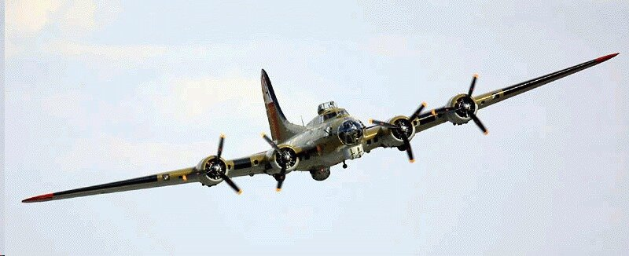
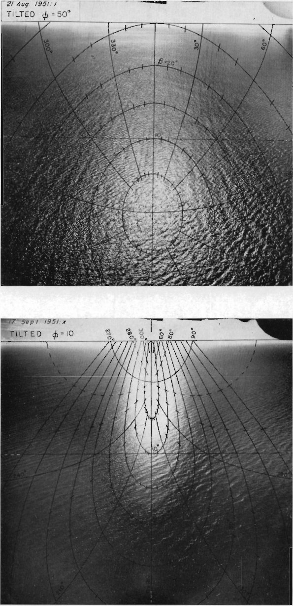

Cox & Munk: the glitter as a measurement
========================================

A century after Spooner, the splendour of the waves became a **measurement**.
Charles S. Cox and Walter H. Munk, of the Scripps Institution of Oceanography,
turned the photographs of the Sun glitter into the first statistics of the sea
surface slopes [CoxMunk1954]_. Their model is the basis of the ``coxmunk``
package.

The authors
-----------

.. list-table::
   :widths: 35 65

   * - .. figure:: ../../../illustration/history/walter_munk_2010_crafoord_prize.jpg
          :width: 100%
          :alt: Walter Munk in 2010

          Walter Munk at the Crafoord Prize press conference, Stockholm, 2010.
          Photo: Holger Motzkau, `Wikimedia Commons
          <https://commons.wikimedia.org/wiki/File:Crafoordprize_2010-11_(cropped).jpg>`__,
          CC BY-SA 3.0.
     - **Walter H. Munk** (1917-2019) spent his career at Scripps, where he
       worked on wind waves and swell, ocean currents, tides and ocean
       acoustics. He received the Crafoord Prize in geosciences in 2010.

       **Charles S. "Chip" Cox** (died 2015) obtained his PhD in oceanography
       at Scripps in 1954 with this work on the sun glitter, and later became
       a professor at Scripps, known for his studies of electromagnetic
       phenomena in the ocean and of sea-floor pressure.

       More than half a century later, Munk revisited the slope statistics of
       the 1950s in the light of new observations [Munk2009]_.

The 1951 campaign off Hawaii
----------------------------

In 1951, Cox and Munk mounted cameras in the bomb bay of a surplus World War II
B-17G aircraft and photographed the Sun glitter on the Pacific Ocean near the
Hawaiian Islands, while the wind was measured from a vessel, the *Reverie*,
below. The brightness at each point of the glitter photographs gives the
probability that a facet of the sea surface has the slope needed to reflect the
Sun toward the camera.

   A B-17G Flying Fortress, the type of aircraft used by Cox and Munk in 1951
   (here the Collings Foundation "Nine O Nine"). Photo: US Federal Government,
   public domain, `Wikimedia Commons
   <https://commons.wikimedia.org/wiki/File:Collings_Foundation_B-17G_Flying_Fortress_%22Nine_O_Nine%22_in_Flight.jpg>`__.

The photographs were taken with the camera tilted at different angles
:math:`\phi` from the nadir, so the glitter is seen from overhead down to the
horizon. On each print, Cox and Munk drew a grid giving, for every point of the
image, the azimuth :math:`\alpha` and the tilt :math:`\beta` that a facet of the
sea surface must have to reflect the Sun toward the camera. Reading the
brightness along this grid gives the slope distribution directly.

.. list-table::
   :widths: 50 50

   * - .. figure:: ../../../illustration/history/cox_munk_1951_glitter_photographs_b.jpg
          :width: 100%
          :alt: Sun glitter photographs, camera tilted 75 and 30 degrees

          Camera tilted at :math:`\phi = 75^\circ` (top) and
          :math:`\phi = 30^\circ` (bottom, 17 September 1951). The small circle
          at the lower right of the top image is the *Reverie*.
     - .. figure:: ../../../illustration/history/ernst_1925_mer_et_soleil.jpg
          :width: 100%
          :alt: Mer et soleil, Max Ernst, 1925

          *Mer et soleil*, Max Ernst, 1925.

The name of the vessel echoes the *Rêveries* of Augustin Fresnel, the essay of
1814 in which the young engineer gathered his first "musings" on the nature of
light, before founding the wave theory and the reflection coefficients
:math:`R_F` used below. The essay has not survived (`Fresnel's lost works
<https://en.wikipedia.org/wiki/Augustin-Jean_Fresnel#Lost_works>`__).

   Camera tilted at :math:`\phi = 50^\circ` (top, 21 August 1951) and
   :math:`\phi = 10^\circ` (bottom, 17 September 1951). Lines of constant facet
   tilt :math:`\beta` (10°, 20°, ...) circle the glitter.

Aerial photographs of the Sun glitter, Cox and Munk, 1951 (from *Slopes of the
sea surface deduced from photographs of sun glitter*, Scripps Institution of
Oceanography, 1956).

From glitter to slope statistics
--------------------------------

The brightness of the glitter at a given point of the image is proportional to
the number of facets oriented to reflect the Sun toward the camera, i.e., to the
slope probability density :math:`P` (:doc:`../algorithms`):

.. math::

   I_{glint} = \frac{\pi \, R_F(\omega) \, P(z_{up}, z_{cr})}{4 \, \mu_s \, \mu_v \cos^4\theta_n},
   \qquad
   P(z_{up}, z_{cr}) = f(\text{wind speed}, \text{wind direction})

The first factor is the Fresnel reflectance :math:`R_F` of a single facet, known
since the 19th century. The second is the distribution of the waves, which Cox
and Munk measured. Written with the normalized slopes
:math:`\xi = z_{cr}/\sigma_{cr}` and :math:`\eta = z_{up}/\sigma_{up}`, it is a
Gaussian corrected by a Gram-Charlier series:

.. math::

   P(\xi, \eta) = \frac{e^{-(\xi^2 + \eta^2)/2}}{2\pi\,\sigma_{cr}\,\sigma_{up}}
   \Big[ 1
   - \tfrac{c_{21}}{2}\,(\xi^2 - 1)\,\eta
   - \tfrac{c_{03}}{6}\,(\eta^2 - 3)\,\eta
   + \tfrac{c_{40}}{24}\,(\xi^4 - 6\xi^2 + 3)
   + \tfrac{c_{22}}{4}\,(\xi^2 - 1)(\eta^2 - 1)
   + \tfrac{c_{04}}{24}\,(\eta^4 - 6\eta^2 + 3)
   \Big]

The major contribution, however, is simpler to state: **the sunglint
reflectance is proportional to** :math:`P(z_{up}, z_{cr})`, **which is a
function of the wind speed and direction**.

From the photographs, Cox and Munk derived:

* the mean square slopes in the upwind and crosswind directions, increasing
  linearly with the wind speed;
* the departure of the slope distribution from a Gaussian, described by a
  Gram-Charlier expansion with skewness and peakedness coefficients
  (:eq:`pdf_gc`);
* the effect of slicks, which damp the small waves and reduce the slopes.

The glitter pattern is therefore a picture of the wind at the sea surface. Their
papers [CoxMunk1954]_ (*J. Opt. Soc. Am.*, and *Statistics of the sea surface
derived from sun glitter*, *J. Mar. Res.*, 13, 198-227, 1954) and the
detailed report *Slopes of the sea surface deduced from photographs of sun
glitter* (Scripps Institution of Oceanography, 1956) had been cited more than
2400 times by 2019. The ``cm_iso`` and ``cm_dir`` statistics of ``coxmunk``
are those of Cox and Munk; ``bh2006`` is their reassessment from satellite data
[BreonHenriot2006]_.

The :doc:`../tutorials/kumatage` tutorial uses the model to simulate the
kumatage seen from the deck of a ship. The next step of this history is
:doc:`the satellite era <satellite_era>`.
